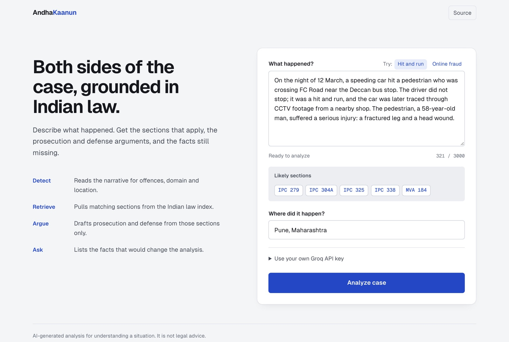
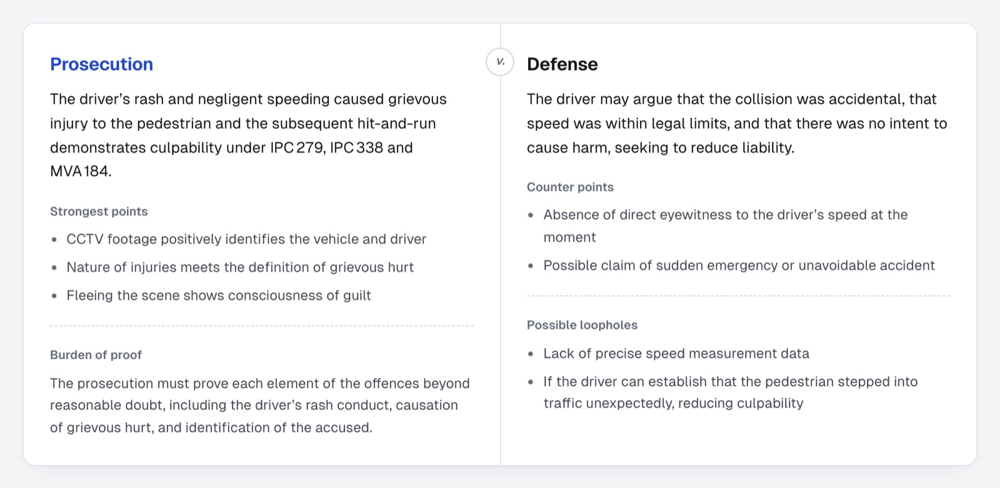
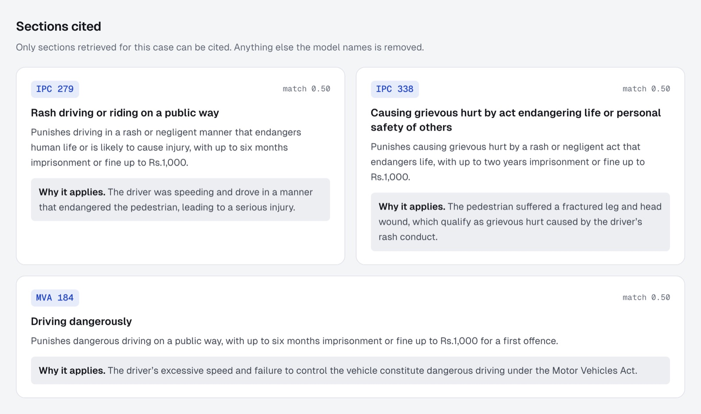
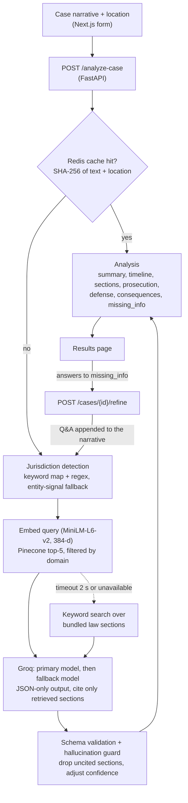
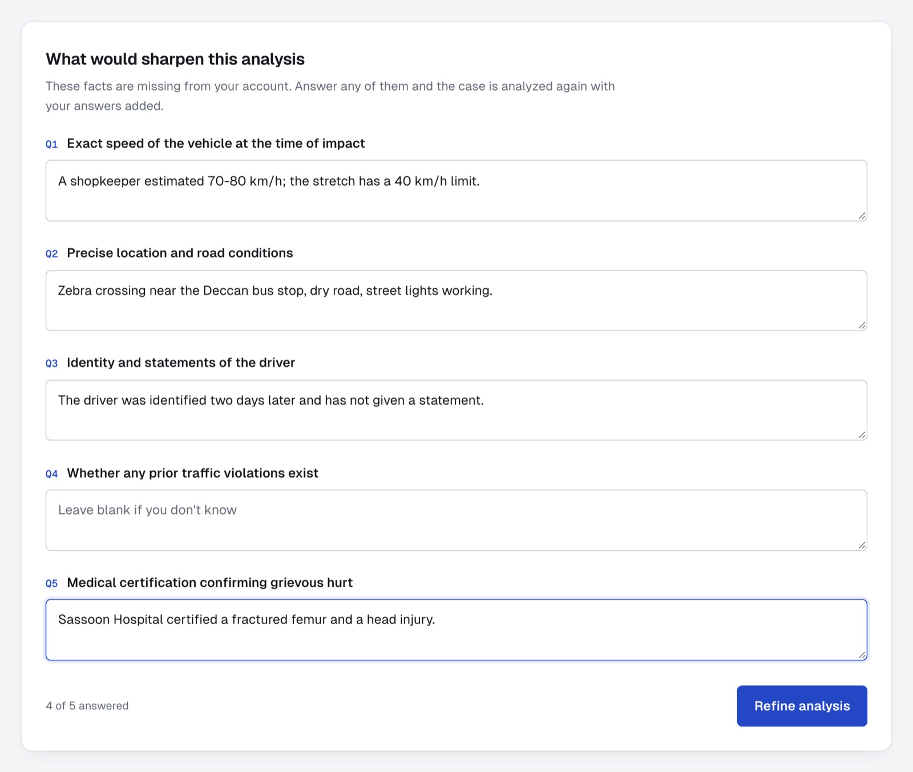
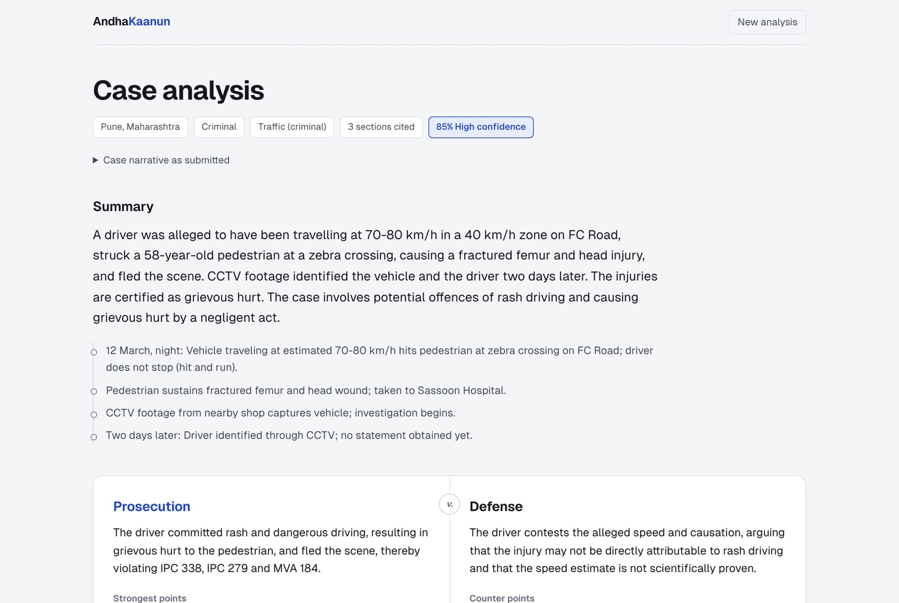
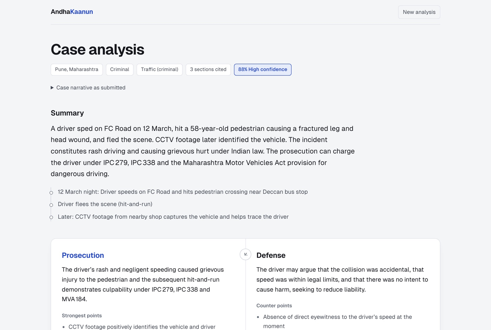

# AndhaKaanun

**Two sides of an argument, grounded in Indian law.**

Describe an incident in plain language. AndhaKaanun finds the Indian law sections that apply, drafts the prosecution's and the defense's arguments using only those sections, and asks for the facts it is missing. Answer those questions and the case is analyzed again.

<p align="center">
  <picture>
    <source media="(prefers-color-scheme: dark)" srcset="docs/screenshots/01-input-dark.jpg">
    
  </picture>
</p>

<table>
  <tr>
    <td width="50%"></td>
    <td width="50%"></td>
  </tr>
  <tr>
    <td align="center"><sub>Prosecution v. defense, each with points, burden of proof and loopholes</sub></td>
    <td align="center"><sub>Sections cited, each with the reason it applies</sub></td>
  </tr>
</table>

<sub>Screenshots are from a local run using <code>openai/gpt-oss-120b</code> on Groq with keyword-fallback retrieval (no Pinecone index configured), which is why every match score reads 0.50. More below.</sub>

---

## What it does

- **Detects jurisdiction as you type.** A keyword and regex pass maps phrases such as "hit and run", "fraud" or "hacked" to likely sections (IPC, IT Act, Motor Vehicles Act, Domestic Violence Act) and legal domains, shown as live badges.
- **Retrieves the law.** The narrative is embedded with `all-MiniLM-L6-v2` and matched against a Pinecone index of law sections, filtered by the detected domains. If Pinecone is slow (over 2 s) or unavailable, a keyword search over the bundled sections takes over.
- **Argues both sides.** Groq generates a structured JSON analysis: summary, timeline, cited sections, prosecution argument with burden of proof, defense argument with possible loopholes, and criminal, civil and bail consequences.
- **Refuses to invent law.** The prompt allows only the retrieved sections. A validation step removes any section the model cites that was not retrieved and lowers the confidence score by 0.1 for each one.
- **Asks for missing facts.** The model lists what it doesn't know (`missing_info`). The results page turns that list into questions, and the answers are appended to the case before it is analyzed again.
- **Degrades instead of failing.** Redis, Pinecone and PostgreSQL are all optional. Without them the API skips caching, uses keyword retrieval and keeps cases in memory. If both LLM models fail, it returns the retrieved sections with a low-confidence partial result.

## How it works



| Step | Where |
| --- | --- |
| Live section badges and domain detection | [`apps/api/services/jurisdiction.py`](apps/api/services/jurisdiction.py) |
| Retrieval with Pinecone, keyword fallback | [`apps/api/services/retrieval.py`](apps/api/services/retrieval.py), [`fallback_store.py`](apps/api/services/fallback_store.py) |
| System prompt and `<legal_context>` framing | [`apps/api/services/prompts.py`](apps/api/services/prompts.py) |
| Groq client with primary and fallback models | [`apps/api/services/llm_client.py`](apps/api/services/llm_client.py) |
| Schema validation and hallucination guard | [`apps/api/services/validation.py`](apps/api/services/validation.py) |
| Pipeline, streaming and refinement endpoints | [`apps/api/routers/analyze.py`](apps/api/routers/analyze.py) |

### The refinement loop

<table>
  <tr>
    <td width="50%"></td>
    <td width="50%"></td>
  </tr>
  <tr>
    <td align="center"><sub>Questions come from the model's <code>missing_info</code></sub></td>
    <td align="center"><sub>The refined summary and timeline now include the answers</sub></td>
  </tr>
</table>

<details>
<summary>First-pass analysis (before refinement)</summary>
<br>

</details>

## Tech stack

| Layer | Technology |
| --- | --- |
| Frontend | Next.js 14 (App Router), React 18, TypeScript, CSS Modules, Geist |
| API | FastAPI, Pydantic v2, pydantic-settings, Server-Sent Events (`sse-starlette`) |
| LLM | Groq (`groq` async SDK), JSON response mode, primary and fallback model chain |
| Retrieval | Pinecone, `sentence-transformers/all-MiniLM-L6-v2`, in-memory keyword fallback |
| Storage (optional) | PostgreSQL via SQLAlchemy async + asyncpg, Alembic migrations |
| Cache (optional) | Redis, 1 hour TTL |

## Getting started

### Prerequisites

- Python 3.11 or newer (developed on 3.12)
- Node.js 18 or newer
- A [Groq API key](https://console.groq.com/keys)
- Optional: a Pinecone index, PostgreSQL and Redis

### 1. Configure

```bash
cp .env.example .env
```

| Variable | Required | Default | Notes |
| --- | --- | --- | --- |
| `GROQ_API_KEY` | yes | | The web form can also send a per-request key. |
| `GROQ_MODEL_PRIMARY` | no | `llama-3.3-70b-versatile` | See the model note below. |
| `GROQ_MODEL_FALLBACK` | no | `llama-3.1-8b-instant` | Used if the primary model errors or times out (30 s). |
| `PINECONE_API_KEY` | yes* | | *Must be set, but can be a placeholder. Retrieval then uses keyword search. |
| `PINECONE_INDEX` | no | `andhakaanun-legal` | |
| `DATABASE_URL` | yes* | | *Must be set, but the database doesn't need to be running. Cases then live in memory. |
| `REDIS_URL` | no | `redis://localhost:6379/0` | Caching is skipped if Redis is unreachable. |
| `CORS_ORIGINS` | no | `http://localhost:3000` | Comma-separated. |
| `DEBUG` | no | `false` | `true` enables `/docs` and `/redoc`. |
| `NEXT_PUBLIC_API_URL` | no | `http://127.0.0.1:8000` | Read by the web app's proxy and results page. |

> **Model note.** As of November 2026 Groq no longer serves the two default Llama models; requests return `404 model_not_found`. Set `GROQ_MODEL_PRIMARY=openai/gpt-oss-120b` and `GROQ_MODEL_FALLBACK=openai/gpt-oss-20b` (or any model your key lists at `GET https://api.groq.com/openai/v1/models`).

### 2. Run the API

Run from the repository root, because settings are read from `./.env`.

```bash
python3 -m venv .venv
source .venv/bin/activate
pip install fastapi "uvicorn[standard]" pydantic-settings groq sse-starlette pinecone \
  sentence-transformers "sqlalchemy[asyncio]" asyncpg alembic greenlet "redis[hiredis]" httpx python-dotenv
uvicorn apps.api.main:app --reload --port 8000
```

On startup the log shows which services connected. Lines like `✗ Pinecone unavailable` or `✗ PostgreSQL unavailable` are expected without those services.

### 3. Run the web app

```bash
cd apps/web
npm install
npm run dev
```

Open <http://localhost:3000>, click **Hit and run** or **Online fraud** to load an example, and analyze it.

### 4. Optional: build the Pinecone index

Create a Pinecone index with dimension 384 and cosine metric, set `PINECONE_API_KEY` and `PINECONE_INDEX`, then embed and upsert the bundled sections:

```bash
PYTHONPATH=. python packages/legal-data/embed_laws.py
```

## API

| Method | Path | Purpose |
| --- | --- | --- |
| `POST` | `/analyze-case` | Full analysis. Body: `case_text` (50 to 3000 chars), `location`, optional `groq_api_key`, optional `stream: true` for SSE events (`summary`, `laws`, `perspectives`, `complete`). |
| `POST` | `/detect-jurisdiction` | Fast keyword pass for the live badges. Body: `{ "text": "..." }`. |
| `POST` | `/cases/{id}/refine` | Appends follow-up answers to the case and reruns the pipeline. |
| `GET` | `/cases/{id}` | Stored case with its latest analysis. |
| `GET` | `/cases` | Paginated case list (needs PostgreSQL; empty otherwise). |
| `GET` | `/health` | Status of PostgreSQL, Redis and Pinecone, plus uptime. |
| `POST` | `/feedback` | Marks an analysis helpful or not, with an optional comment. |

## Project structure

```
andhakaanun/
├── apps/
│   ├── api/                      FastAPI backend
│   │   ├── main.py               app factory, lifespan (Redis, Pinecone, Postgres), error handlers
│   │   ├── config.py             environment settings
│   │   ├── routers/              analyze.py, cases.py, system.py
│   │   ├── services/             jurisdiction, retrieval, embeddings, prompts, llm_client,
│   │   │                         reasoning, validation, cache, fallback_store
│   │   ├── models/schemas.py     request and response models
│   │   └── db/                   SQLAlchemy models, CRUD, Alembic migrations
│   └── web/                      Next.js frontend
│       └── app/
│           ├── page.tsx          case input with live section badges
│           ├── results/[id]/     analysis page and follow-up form
│           └── api/proxy/        forwards browser requests to the API
├── packages/legal-data/          laws.json and the Pinecone embedding script
├── docs/screenshots/
└── docker-compose.yml
```

## Limitations

- **Small, IPC-era law set.** Retrieval covers 15 sections in `laws.json` (17 in the keyword fallback) across the IPC, IT Act, Motor Vehicles Act and Domestic Violence Act. The IPC was replaced by the Bharatiya Nyaya Sanhita on 1 July 2024, and the BNS equivalents are not mapped yet.
- **Score is neutral under fallback.** Keyword-fallback results get a fixed 0.50 similarity score; real scores need the Pinecone index.
- **Memory-only without a database.** Cases are lost when the API restarts.
- **Setup files need work.** `pyproject.toml` can't be installed with pip as written (Poetry-style tables, and `groq` and `sse-starlette` are missing), so use the install command above. The API Dockerfile copies a root `alembic.ini` that doesn't exist, and `docker-compose.yml` has an invalid `depends_on`. The CI workflow runs `pytest` against a `tests/` folder that doesn't exist yet.
- **Rate limiting isn't enforced.** `RATE_LIMIT_PER_HOUR` is read into settings but nothing uses it yet.

## Disclaimer

AndhaKaanun is an educational project. Its output is AI-generated and is **not legal advice**. Always consult a qualified lawyer about a real legal matter.

## License

MIT, as declared in [`pyproject.toml`](pyproject.toml).

## Author

**Ayush Chougula**, AI engineer
[ayushchougula.in](https://ayushchougula.in) · [GitHub](https://github.com/ayushcody) · [LinkedIn](https://linkedin.com/in/ayushchougula)
